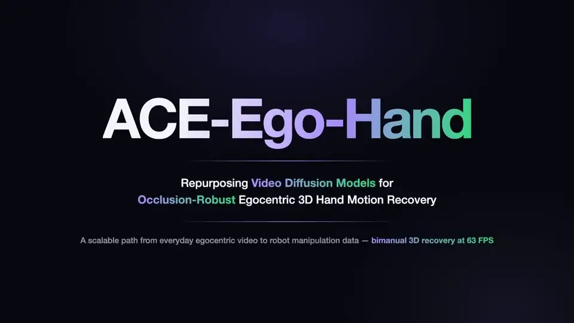
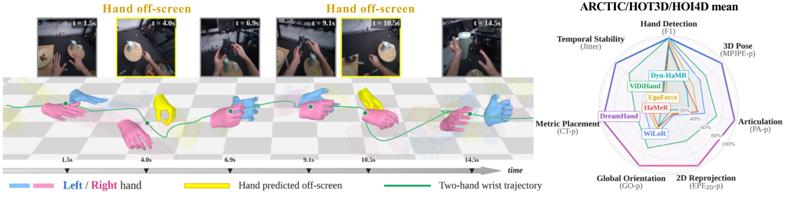
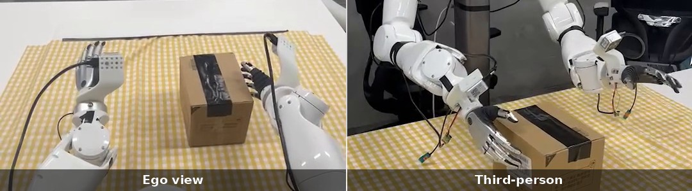

<div align="center">

<h1 align="center">ACE-Ego-Hand: Repurposing Video Diffusion Models for<br>Occlusion-Robust Egocentric 3D Hand Motion Recovery</h1>

<h3 align="center">
<a href="https://ggxxii.github.io/ace-ego-hand/">Webpage</a> |
<a href="https://arxiv.org/abs/2608.20308">Paper</a> |
<a href="https://huggingface.co/ACERobotics/ACE-Ego-Hand">Checkpoints</a> |
<a href="https://egohandbench.github.io/">EgoHandBench</a>
</h3>

<p align="center">
  &nbsp;
  &nbsp;
  &nbsp;
  
</p>

[Yufei Liu](https://ggxxii.github.io/)<sup>1,4</sup>,
Xixi Wang<sup>2</sup>,
[Hao Li](https://scholar.google.com/citations?view_op=list_works&hl=zh-CN&hl=zh-CN&user=D-8csxoAAAAJ)<sup>3,4</sup>,
[Ganlong Zhao](https://scholar.google.com/citations?user=4l2zOz4AAAAJ&hl=zh-CN)<sup>3,4</sup>,
Kaitong Cai<sup>4</sup>,
Chengkai Jin<sup>2,4</sup>,
Chunxiao Liu<sup>4</sup>,
Jianbo Liu<sup>4</sup>,
[Siyuan Huang](https://scholar.google.com/citations?user=QNkS4KEAAAAJ&hl=en)<sup>4</sup>&nbsp;&#8224;,
[Xingang Pan](https://xingangpan.github.io/)<sup>2</sup>,
[Hongsheng Li](https://scholar.google.com/citations?user=BN2Ze-QAAAAJ&hl=en)<sup>3,4</sup>&nbsp;&#9993;

<sup>1</sup>SJTU &nbsp; <sup>2</sup>NTU &nbsp; <sup>3</sup>CUHK &nbsp; <sup>4</sup>ACE Robotics<br>
&#8224; Project leader &nbsp; &#9993; Corresponding author

</div>

<p align="center">
  
</p>

## News

- **November 24, 2026** — 🎉🎉🎉 We release **[ViDiHand2](https://vidihand2.github.io/)** , our latest video-diffusion
  model for hand motion reconstruction
  ([arXiv](https://arxiv.org/abs/2611.30597) |
  [Code](https://github.com/NTUYWANG103/ViDiHand) |
  [🤗 Demo](https://huggingface.co/spaces/WANG-XIXI/ViDiHand2) |
  [🤗 Checkpoints](https://huggingface.co/WANG-XIXI/ViDiHand)).
- **November 7, 2026** — ACE-Ego-Hand joins
  [EgoHandBench](https://egohandbench.github.io/)
  ([Code](https://github.com/NTUYWANG103/EgoHandBench)), a unified
  benchmark for egocentric hand reconstruction — see
  [EgoHandBench](#-egohandbench).
- **September 10, 2026** — Inference code and the K-given / K-free checkpoints
  released.
- **August 20, 2026** — Paper released on
  [arXiv](https://arxiv.org/abs/2608.20308).

## ✨ Highlights

<p align="center">
  
</p>

- ⚡ **63 fps on one A100** — one deterministic pass makes ACE-Ego-Hand fast
  as well as accurate.
- 🎞 **A video diffusion model as a deterministic geometry encoder** — a single forward pass over its clean latent exposes scene content beyond current observations.
- 🖐 **Continuous bimanual trajectories with metric placement** — MANO pose, shape and camera-space translation for both hands, per frame, with no external detector.
- 🏆 **State of the art on five egocentric benchmarks** — cuts MPJPE-p by 30%
  on occlusion-heavy ARCTIC and 40% on HOT3D.
- 🤖 **From human video to robot data** — a scalable path from everyday
  egocentric video to robot manipulation data.

<p align="center">
  
</p>

<p align="center"><em>Our trajectories are executable: retargeted onto a bimanual dexterous robot, the same motion runs on hardware.</em></p>

## 🛠 Installation

```bash
conda create -n ace-ego-hand python=3.10 && conda activate ace-ego-hand
pip install -r requirements.txt
```

The Wan backbone is loaded through VideoX-Fun. Clone it to `third_party/`:

```bash
git clone https://github.com/aigc-apps/VideoX-Fun third_party
```

Get the official release ([mano.is.tue.mpg.de](https://mano.is.tue.mpg.de), research licence) and convert it once — the official pickles embed `chumpy`, which no longer imports on modern numpy, so the converter rewrites them as plain-numpy pickles:

```bash
python scripts/convert_mano_pkls.py --src /path/to/mano_v1_2/models --dst data/mano/mano
```

## 📦 Checkpoints

Download `Wan2.2-Fun-5B-Control` from the VideoX-Fun release to
`ckpt/Wan2.2-Fun-5B-Control/` (needs `config.json`,
`diffusion_pytorch_model.safetensors`, `Wan2.2_VAE.pth`,
`models_t5_umt5-xxl-enc-bf16.pth` and `google/umt5-xxl/`), then precompute the
fixed caption embedding once:

```bash
python scripts/precompute_caption.py
```

Ours come from [🤗 ACERobotics/ACE-Ego-Hand](https://huggingface.co/ACERobotics/ACE-Ego-Hand)
and go in `checkpoints/`:

| Model | Checkpoint | Config | Camera intrinsics | |
| :-- | :-- | :-- | :-- | :-- |
| K-given | `ace_ego_hand_k.pt` | `options/ace_ego_hand_k.yml` | required | [download](https://huggingface.co/ACERobotics/ACE-Ego-Hand/resolve/main/ace_ego_hand_k.pt) |
| K-free | `ace_ego_hand_kfree.pt` | `options/ace_ego_hand_kfree.yml` | not needed | [download](https://huggingface.co/ACERobotics/ACE-Ego-Hand/resolve/main/ace_ego_hand_kfree.pt) |
| K-given, retrained on [EgoHandBench](#-egohandbench) | `ace_ego_hand_k_ehb.pt` | `options/ace_ego_hand_k_ehb.yml` | required | [download](https://huggingface.co/ACERobotics/ACE-Ego-Hand/resolve/main/ace_ego_hand_k_ehb.pt) |

```bash
pip install -U "huggingface_hub[cli]"
hf download ACERobotics/ACE-Ego-Hand --local-dir checkpoints
```

> ⚠️ **Pinhole only.** The released checkpoints do not support native fisheye
> input. To run on fisheye footage, undistort it to a pinhole view first and
> pass the pinhole intrinsics.

## 🚀 Quick Start

```bash
# K-free: no camera parameters needed at all
python infer_video.py --video clip.mp4 \
    --opt options/ace_ego_hand_kfree.yml --ckpt checkpoints/ace_ego_hand_kfree.pt \
    --out results/clip

# K-given: pass the camera calibration
python infer_video.py --video clip.mp4 --camera cam.json \
    --opt options/ace_ego_hand_k.yml --ckpt checkpoints/ace_ego_hand_k.pt \
    --out results/clip
```

`cam.json` gives the intrinsics at the calibration's resolution; they are
rescaled to the video automatically (or pass `--intrinsics fx,fy,cx,cy`):

```json
{"image_width": 1280, "image_height": 720,
 "frames": [{"intrinsics": {"fx": 736.6, "fy": 736.6, "cx": 640.0, "cy": 360.0}}]}
```

Render an overlay (`--mesh` draws the MANO mesh, CPU only):

```bash
python scripts/viz_preds.py --pred_dir results/clip --video clip.mp4 \
    --out results/clip_viz --mesh
```

## 🏆 EgoHandBench

[EgoHandBench](https://egohandbench.github.io/)
([Code](https://github.com/NTUYWANG103/EgoHandBench)) is a unified
benchmark for egocentric hand reconstruction, with standardized datasets,
train/test splits, metrics and ready-to-use baselines. ACE-Ego-Hand is one of
its baselines (`baselines/ace_ego_hand`). Run the EgoHandBench-retrained checkpoint with its config:

```bash
python infer_video.py --video clip.mp4 --camera cam.json \
    --opt options/ace_ego_hand_k_ehb.yml --ckpt checkpoints/ace_ego_hand_k_ehb.pt \
    --out results/clip
```


## 🗺 TODO

- [x] [arXiv preprint](https://arxiv.org/abs/2608.20308)
- [x] [Project page](https://ggxxii.github.io/ace-ego-hand/)
- [x] Inference code
- [x] Pretrained checkpoints — K-given and K-free
- [x] EgoHandBench-retrained checkpoint
- [ ] Training code and data preparation scripts

## 📝 Citation

```bibtex
@misc{liu2026aceegohand,
    title={ACE-Ego-Hand: Repurposing Video Diffusion Models for Occlusion-Robust Egocentric 3D Hand Motion Recovery},
    author={Yufei Liu and Xixi Wang and Hao Li and Ganlong Zhao and Kaitong Cai and Chengkai Jin and Chunxiao Liu and Jianbo Liu and Siyuan Huang and Xingang Pan and Hongsheng Li},
    year={2026},
    eprint={2608.20308},
    archivePrefix={arXiv},
    primaryClass={cs.CV},
    url={https://arxiv.org/abs/2608.20308},
}
```

## 🙏 Acknowledgements

Built on [VideoX-Fun](https://github.com/aigc-apps/VideoX-Fun) /
[Wan](https://github.com/Wan-Video/Wan2.2) and
[smplx](https://github.com/vchoutas/smplx).

## ⚖ License

The code is MIT (see [LICENSE](LICENSE)). The checkpoints are CC BY-NC 4.0 —
they derive from MANO and research-licensed datasets (ARCTIC, HOT3D, H2O,
OakInk2, FreiHAND, RHD, Re:InterHand, and the EgoHandBench training sets for
`ace_ego_hand_k_ehb.pt`), so commercial use is not permitted. The Wan weights,
VideoX-Fun and MANO remain under their own licences.
